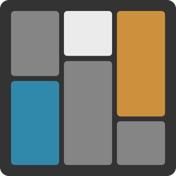
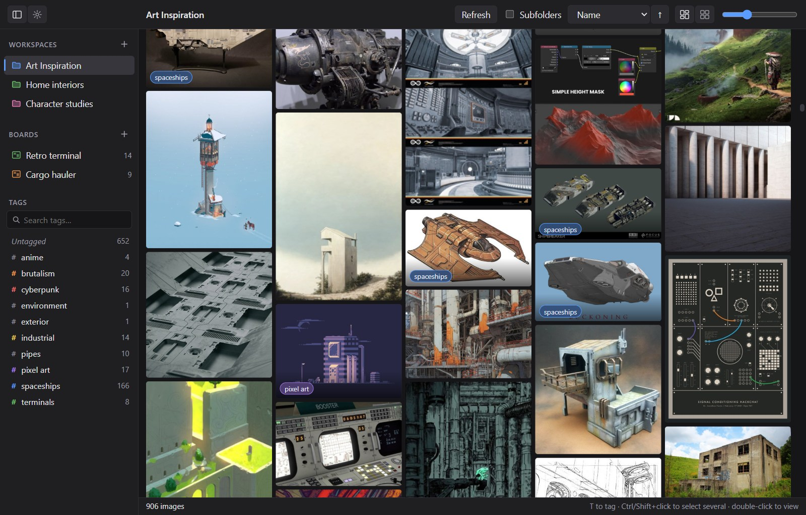
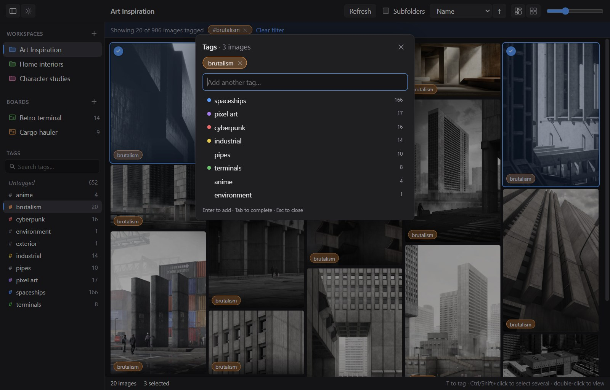
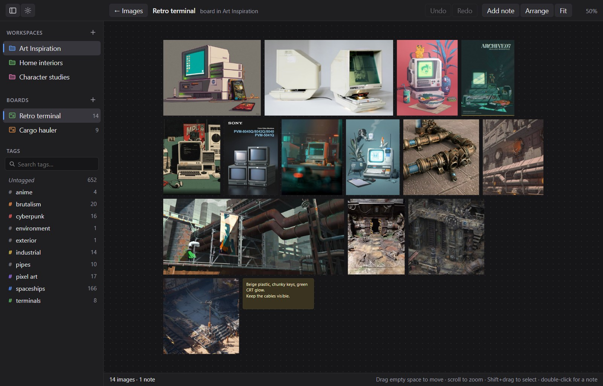

# Reference Drawer

**A lightweight desktop app for collecting, tagging and arranging reference images.**

[Download](https://github.com/KaiGulliksen/reference-drawer/releases/latest) ·
[How to use it](docs/USER_GUIDE.md) ·
[Build it yourself](docs/DEVELOPMENT.md)

Point Reference Drawer at the folders where you keep art inspiration, interiors or anything else
you collect, and browse them as a fast, scrollable wall of images. Your images stay ordinary files
in the folders you already have. There's no account and no cloud, and big folders stay smooth.

## What it does

- **Workspaces** keep separate collections apart. Each one is a folder on your computer.
- **Tags** find things again: tag several images at once, then combine tags to narrow them down.
- **Mood boards** gather the references for one piece on a free canvas, with notes and cropping.
- **Drag images in** from a web browser or another app, and they're saved into the workspace.
- **A full-size viewer** with zoom and pan, and arrow keys to step through a folder.
- **The open folder updates by itself** when images are added, removed or renamed.
- **Tags follow your files**, even when you rename or move them in Explorer or Finder.
- **Keyboard shortcuts** for nearly everything, and the mouse back button closes whatever is on top.

Reads JPG, PNG, WebP, GIF, BMP and AVIF. The [user guide](docs/USER_GUIDE.md) explains every feature.

### Tag several images at once

### Plan a piece on a mood board

## Download

Get the installer from the [latest release](https://github.com/KaiGulliksen/reference-drawer/releases/latest)
(about 4 MB) and run it.

The installer isn't code-signed, so Windows may show a "Windows protected your PC" warning the first
time. Choose **More info**, then **Run anyway**.

| System | Status |
| --- | --- |
| Windows 10 or 11, 64-bit | Supported, and what the app is developed and tested on |
| macOS 12 or later | Written to work, but not tested yet |
| Linux | Written to work, but not tested yet |

For macOS or Linux, you can [build it yourself](docs/DEVELOPMENT.md) for now.

## Your files are safe

Reference Drawer never renames, edits, replaces or deletes your images or folders. Removing a
workspace, tag or board only changes the app's own list. It changes your folders in just two
ways, both when you ask it to:

- images you drag onto the window are saved as new files, never over an existing one;
- *Move to workspace* moves images to another workspace's folder, again never replacing anything.

Your workspaces, tags and boards are stored on your computer and
[backed up automatically](docs/USER_GUIDE.md#where-your-library-is-kept). The app doesn't send your
images anywhere. The only thing it fetches from the internet is an image you dragged in from a
website.

## License

[MIT](LICENSE), by [Kai Gulliksen](https://kaigulliksen.com).

The images in the screenshots come from the author's personal reference collection and belong to
their respective artists. If one of them is yours and you'd like it removed, please open an issue.
